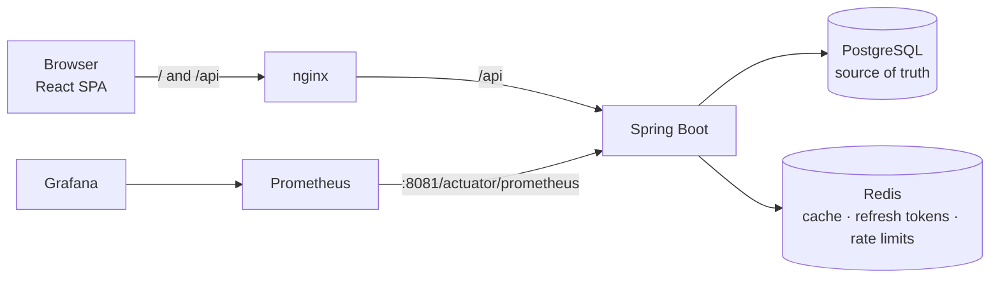

# Lost & Found Platform

A full-stack web app for posting **lost** and **found** items, searching them, getting **automatic match
suggestions** between lost and found posts, and returning items through a **verified claim flow**.

**Stack:** Java 25 · Spring Boot 4 · PostgreSQL 16 · Redis 7 · React 19 + TypeScript · Docker · GitHub Actions · Prometheus + Grafana · k6

## Features

- **Accounts.** Register and log in with a short-lived JWT access token (15 min) and a rotating refresh token
  (7 days) in an HttpOnly cookie.
- **Posts.** Lost/found item posts with category, place, optional GPS coordinates, date and a verification question.
  Only the author can edit or delete a post.
- **Photos.** Up to 5 per post, shown as a display size and a thumbnail. Photos are stripped of metadata (including the
  GPS location phones embed) both in the browser and on the server.
- **Search.**
  - Keyword search over title, description and place. It works for Chinese, which has no spaces between words.
  - Filters for type, category and date range.
  - A "near me" filter with a radius, which also shows the distance.
- **Matching.** Each open post lists the most likely posts of the opposite type, with a 0–100 score and the reasons.
  A strong new match notifies the other post's author.
- **Claims.** Someone answers the verification question and sends a message, and the poster accepts or declines.
  - Accepting one claim declines the others, and only then do both people see each other's email.
  - The poster marks the item as returned to close the post.
- **Notifications.** In-app notifications with an unread badge.
- **Moderation.** Users can report a post. Admins get a dashboard with open reports grouped by post, and can hide a
  post (it disappears from search, matches and its page, but its author still sees it with the reason) or dismiss
  the reports. Hidden posts can be restored.
- **Abuse protection.**
  - Per-IP rate limits on login, register and refresh.
  - An account lockout after repeated wrong passwords.
  - Logins take the same time whether or not the email exists.

## Run it

You need Docker. From the project root:

```bash
cd infra
cp .env.example .env                                         # then edit: set passwords and a JWT_SECRET
sed -i '' "s|^JWT_SECRET=.*|JWT_SECRET=$(openssl rand -base64 48)|" .env   # (macOS) or edit by hand
docker compose --profile app up -d --build
```

Open <http://localhost:8000>. The first build takes a few minutes.

Optional extras:

```bash
docker compose --profile monitoring up -d                     # Grafana → http://localhost:3000
docker exec -i infra-postgres-1 psql -U lostfound -d lostfound < ../load-tests/seed.sql   # 2,000 sample posts
```

## Deploying to Render

The repository includes a Render **Blueprint** (`render.yaml`). It creates three things on Render's free plans,
in the Singapore region:

| Render resource | What it is |
|---|---|
| Web service `lost-and-found` | One container (root `Dockerfile`) serving both the React app and the API |
| Key Value `lost-and-found-redis` | Redis for caching, refresh tokens and rate limits. Private: only our service can reach it |
| PostgreSQL `lost-and-found-db` | The database. No access from the internet by default |

Steps:

1. Push this repository to GitHub.
2. In the [Render dashboard](https://dashboard.render.com): **New → Blueprint**, connect the repository, then **Apply**.
3. Wait for the first build (about 10 minutes). The site is at `https://lost-and-found-<something>.onrender.com`.

Render generates `JWT_SECRET` and fills in the database and Redis settings. Each push to `main` redeploys.

**To make yourself an admin on Render:**
1. Register on the live site.
2. In the database's **Info** page, under **Networking / Access Control**, temporarily allow your own IP address.
3. Copy the **External Database URL**, then run:
   ```bash
   DATABASE_URL='<External Database URL>' scripts/make-admin.sh you@example.com
   ```
4. Remove your IP address from the allow list again.

**Free-plan limits:**
- The service sleeps after 15 minutes without visitors, and the next visit takes about a minute.
- **Uploaded photos are temporary.** They're stored on the service's own disk, which is wiped whenever it sleeps
  or redeploys. Keeping photos would need a paid instance with a disk, or an S3-compatible store (the
  `PhotoStorage` interface is where that would plug in).
- The free database expires after 30 days.

The same image can be tried locally with Render's 512 MB memory limit. Every end-to-end test was run against it
this way, with the Content-Security-Policy active.

## Admin accounts

There is no way to become an admin through the website. Register normally, then run on the server:

```bash
scripts/make-admin.sh someone@example.com            # make admin
scripts/make-admin.sh someone@example.com --revoke   # back to a normal user
```

The role is read from the database at login and stored in the access token, so it applies at the next login
or within 15 minutes. Promoting by an email listed in a config file was avoided on purpose: emails aren't
verified, so someone could register that address first.

## Develop

Run the databases in Docker, and the backend and frontend on your machine. You get hot reload, and the Vite dev
server forwards `/api` to the backend.

```bash
cd infra && docker compose up -d                 # Postgres + Redis
cd backend && ./gradlew bootRun                  # API on :8080, health/metrics on :8081
cd frontend && npm install && npm run dev        # http://localhost:5173
```

Requirements: Java 25, Node 20+, Docker.

## Architecture



**Backend layout.** Each feature package under `backend/src/main/java/com/lostfound/backend/` has a controller, a
service and a repository, and the API only ever sends DTOs, never JPA entities.

| Package | What it does |
|---|---|
| `auth` | register, login, JWT access tokens, refresh-token rotation |
| `user` | the `users` table, `/api/me` |
| `item` | posts, search (`ItemSpecifications`), caching |
| `match` | scoring (`MatchScorer`, `TextSimilarity`) and top-K selection (`TopK`) |
| `claim` | the claim lifecycle, with a row lock so two approvals can't both win |
| `notification` | in-app notifications |
| `moderation` | reports, hiding posts, the admin API |
| `photo` | uploads, image checks and resizing (`ImageProcessor`), storage (`PhotoStorage`) |
| `security` | rate limiting and account lockout (Redis counters) |
| `config` | security, JWT keys, cache setup |

The database schema is managed by Flyway (`backend/src/main/resources/db/migration`).

### How the main parts work

**Keyword search.** Uses `ILIKE '%…%'` backed by **pg_trgm** trigram GIN indexes. Postgres's built-in full-text search
treats "撿到一個咖啡色皮夾" as one word, so a search for "皮夾" would miss it. Trigrams find any part of the text.

**"Near me".** A latitude/longitude box first, which can use an index, then an exact distance check inside the box.
The response includes the Haversine distance.

**Matching.** Candidates are open posts of the opposite type, by someone else, within ±30 days. Each one is scored
0–1 as a weighted sum of four signals:

| Signal | Weight | Rule |
|---|---|---|
| Same category | 35% | all or nothing |
| Time | 20% | linear over 30 days; "found" well before "lost" is penalised |
| Distance | 25% | linear over 5 km; partial credit when coordinates are missing |
| Text | 20% | cosine similarity; Chinese is split into two-character bigrams, English into words |

A size-K min-heap keeps the best results in O(n log k).

**Caching (Redis).**
- Item details are cached for 10 minutes, and search and match results for 1 minute.
- Every write clears the affected entries **after the transaction commits**, so stale data can't be re-cached.
- If Redis is down, the app falls back to the database instead of failing.

**Photos.**
- The browser shrinks each photo to 1600 px, applies its rotation and re-draws it on a canvas, which drops all
  metadata, before uploading.
- The server doesn't trust that. It checks the file's first bytes (only JPEG and PNG), reads the dimensions *before*
  decoding (anything over 40 megapixels is rejected as a decompression bomb), and re-encodes a clean JPEG plus a
  400 px thumbnail.
- File names are server-generated UUIDs. Files go to disk through the `PhotoStorage` interface: a Docker volume today,
  and an S3 implementation could replace it for cloud hosting. Deleting a photo or a post removes its files after the
  database commit.

**Auth.**
- The refresh token is 32 random bytes in an HttpOnly, `SameSite=Strict` cookie scoped to `/api/auth`.
- Redis stores only its SHA-256 hash.
- Each refresh consumes it atomically (`GETDEL`) and issues a new one.
- The frontend refreshes on a 401 and retries the request. Parallel requests share one refresh.

## API

All endpoints are under `/api`. Errors are RFC 7807 problem details (`{"status":404,"detail":"Item not found",…}`).

| Method | Path | Auth | |
|---|---|---|---|
| POST | `/auth/register`, `/auth/login`, `/auth/refresh`, `/auth/logout` | – | account and session |
| GET | `/me`, `/me/items`, `/me/claims` | ✓ | the current user's data |
| GET | `/items?q=&type=&categoryId=&status=&from=&to=&lat=&lng=&radiusKm=&page=&size=` | – | search |
| GET | `/items/{id}`, `/items/{id}/matches`, `/categories` | – | details |
| POST / PUT / DELETE | `/items`, `/items/{id}` | ✓ owner | create, edit, delete |
| POST | `/items/{id}/claims` | ✓ | claim someone's post |
| GET | `/items/{id}/claims` | ✓ owner | see claims on your post |
| POST | `/claims/{id}/approve`, `/claims/{id}/reject`, `/items/{id}/returned` | ✓ owner | decide and close |
| GET / POST | `/notifications`, `/notifications/{id}/read`, `/notifications/read-all` | ✓ | notifications |
| POST / DELETE | `/items/{id}/photos` (multipart `file`), `/items/{id}/photos/{photoId}` | ✓ owner | add or remove a photo |
| GET | `/photos/{uuid}.jpg`, `/photos/{uuid}_thumb.jpg` | – | photo files (cached by browsers for a year) |
| POST | `/items/{id}/reports` | ✓ | report someone else's post |
| GET | `/admin/stats`, `/admin/reports?status=`, `/admin/items/hidden` | admin | moderation dashboard |
| POST | `/admin/items/{id}/hide`, `/admin/items/{id}/unhide`, `/admin/items/{id}/dismiss-reports` | admin | moderation actions |

## Testing

```bash
cd backend && ./gradlew test     # 87 tests: unit + integration (Testcontainers starts real Postgres and Redis)
cd frontend && npm test          # 33 unit and component tests (Vitest + Testing Library)

# End-to-end: a real browser clicks through the running site (Playwright)
cd infra && APP_RATELIMIT_ENABLED=false docker compose --profile app up -d --build
scripts/make-admin.sh <an account you registered>     # for the moderation test
cd frontend && E2E_ADMIN_EMAIL=<that email> npm run test:e2e
```

- **Unit tests** cover the matching algorithm (tokenizing, scoring rules, and `TopK` checked against a full sort on
  10,000 random numbers) and image processing (resizing, EXIF removal, fake files, decompression bombs).
- **Integration tests** cover every endpoint with MockMvc against real databases, including:
  - permissions (only owners can edit, only posters can approve)
  - the full claim flow
  - cache invalidation
  - refresh-token rotation and reuse
  - rate limiting and account lockout
- **Frontend tests** cover:
  - the API client: refreshing on 401, sharing one refresh between parallel requests, logging out only when the
    refresh token is really rejected, translated error messages
  - form validation, the login redirect, and what the claim section shows to visitors and posters
- **End-to-end tests** (Playwright, real Chrome) run the whole story: register → post a found item with a photo →
  another user finds it by search and claims it → the finder is notified, accepts, sees the contact email and
  marks it returned. A second test covers moderation: report → admin hides → gone from search → the author is told
  why. These tests caught real bugs: posts dated "today" were rejected between midnight and 8 a.m. in
  Taiwan, because the server compared dates in UTC; reports showed an error although they succeeded (an empty `201`
  response); and logging out on a login-only page landed on the login page instead of home.
- **Load tests** use k6 (`load-tests/browse.js`). The latest numbers are in **[docs/perf.md](docs/perf.md)**:
  - about 4,300 requests/s on a laptop
  - p95 latency of 9 ms under stress
  - caching match results cut p99 latency by 75%

CI (GitHub Actions) runs on every push and pull request:
1. Backend tests.
2. Frontend lint, tests and build.
3. End-to-end tests against the whole site running in Docker.
4. Build both Docker images. On `main` they're also pushed to `ghcr.io`.

## Monitoring

`docker compose --profile monitoring up -d` starts Prometheus and Grafana with a ready-made dashboard showing:
- requests per second and p95 latency per endpoint
- error rate
- cache hit ratio
- database connection pool
- JVM heap
- business activity (posts, claims, match notifications)
- rate-limited requests

Metrics are served on the management port **8081**, which is separate from the public port 8080.

## Configuration

| Variable | Default | |
|---|---|---|
| `JWT_SECRET` | dev-only value | **required in Docker**; at least 32 characters. The app refuses to start with a shorter one |
| `REFRESH_COOKIE_SECURE` | `false` | set `true` when served over HTTPS |
| `SPRING_DATASOURCE_URL` / `_USERNAME` / `_PASSWORD` | local Postgres | |
| `SPRING_DATA_REDIS_HOST` | `localhost` | |
| `SERVER_FORWARD_HEADERS_STRATEGY` | – | `native` behind a reverse proxy, so rate limits see the real client IP |
| `APP_RATELIMIT_ENABLED` | `true` | turn off for load tests that log in a lot |
| `PHOTO_STORAGE_DIR` | `./data/photos` | where uploaded photos are saved (`/data/photos` volume in Docker) |

## Not done yet

- S3 storage for photos. Photos are on a local volume today, which is fine for one server, but on Render's free
  plan they don't survive a restart.

## Project structure

```
backend/      Spring Boot API (Dockerfile included)
frontend/     React + TypeScript app, served by nginx in Docker
infra/        docker-compose, Prometheus config, Grafana dashboard
load-tests/   k6 scripts and sample data
docs/         performance results
plan.md       the original project plan
```
